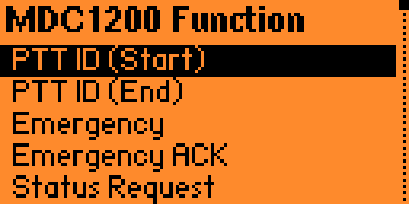

# MDC1200 (Momentum)

A Flipper Zero application (FAP) for **encoding, transmitting, receiving, and decoding MDC1200** signaling on PMR446 and FRS channels.  
Built for the **Momentum** firmware.

> ⚠️ **LEGAL DISCLAIMER**  
> Transmitting on PMR446 and FRS frequencies is **strictly regulated** in most countries.  
> Using a non‑certified device (such as the Flipper Zero) to transmit on these bands is **illegal**.  
> This software is provided **for educational and research purposes only**.  
> The author assumes **no responsibility** for any unauthorized or unlawful use.  
> Always comply with your local radio regulations.

---

## Features

- **MDC1200 transmission:** Generate and transmit MDC1200 signaling packets.
- **MDC1200 reception:** Monitor incoming signals and decode supported packets.
- **PMR446 channels:** Select from 16 channel frequencies.
- **FRS channels:** Select from 15 channel frequencies.
- **Function selection:** Choose from predefined MDC1200 commands.
- **Custom packets:** Configure custom operation and argument bytes.
- **Radio ID editing:** Set destination and source IDs where applicable.
- **Call Alert:** Support for two-codeword call signaling.
- **Selective Call:** Support for two-codeword selective-call signaling.
- **Live reception log:** View decoded messages, IDs, timestamps, and command types.
- **Channel switching:** Change channels and switch between PMR and FRS.
- **Polarity selection:** Select normal or inverted transmission polarity.
- **On-device interface:** Navigate using the Flipper Zero directional pad and OK/Back buttons.

## Supported MDC1200 Functions

| Function | Description |
|---|---|
| PTT ID (Start) | PTT identification at transmission start |
| PTT ID (End) | PTT identification at transmission end |
| Emergency | Emergency signaling |
| Emergency ACK | Emergency acknowledgment |
| Status Request | Request radio status |
| Radio Check | Radio check request |
| Radio Check ACK | Radio check acknowledgment |
| Call Alert | Call alert signaling |
| Selective Call | Selective-call signaling |
| Remote Monitor | Remote monitoring command |
| Radio Enable | Radio enable command |
| Radio Disable | Radio disable command |
| Disable ACK | Radio disable acknowledgment |
| Enable ACK | Radio enable acknowledgment |
| Request to Talk | Request-to-talk signaling |
| General ACK | General acknowledgment |
| Send Status | Send a selectable status value |
| Status Response | Send a selectable status response |
| Message | Send a selectable message value |
| Custom | Configure a custom operation and argument |

**Note:** Actual behavior depends on radio compatibility, protocol implementation, configuration, and the receiving radio system.

## Interface

### Receive
- Monitor MDC1200 traffic on the selected channel.
- Display decoded operation codes and radio IDs.
- View timestamps and reception statistics.
- Switch channels and frequency bands.
- Clear the reception log.

### Transmit
- Select a predefined signaling function.
- Configure radio IDs and applicable arguments.
- Select the PMR or FRS channel.
- Change transmission polarity.
- Trigger packet transmission.

### About
Displays the application name, version, and author.

## Technical Overview

The application is implemented in C using the Flipper Zero firmware APIs.

Main components:

- **Sub-GHz hardware:** CC1101 radio interface.
- **Custom radio preset:** Configured through the application's preset data.
- **Asynchronous reception:** Collects signal transitions for decoding.
- **Asynchronous transmission:** Generates a modulated bitstream.
- **MDC1200 decoder:** Detects synchronization, decodes codewords, applies forward error correction, and validates CRC.
- **Reception log:** Stores recently decoded messages in memory.

The implementation uses seven data bytes per codeword, with additional forward-error-correction data and bit interleaving.

## Installation

1. Compile the application using a compatible Flipper Zero firmware development environment.
2. Package it as a Flipper Application Package (FAP).
3. Copy the resulting `.fap` file to the Flipper Zero.
4. Launch it from the appropriate application category.

The exact build configuration depends on the repository's manifest and installed Momentum SDK.

## Controls

| Button | Action |
|---|---|
| Up / Down | Navigate menus or edit values |
| Left / Right | Change channels or move between editable fields |
| OK | Select an item or transmit |
| Long OK in Receive | Clear the reception log |
| Back | Return to the previous screen |

Controls may behave differently depending on the active screen.

## Compatibility

- **Device:** Flipper Zero
- **Firmware:** Momentum
- **Language:** C
- **Radio:** CC1101 Sub-GHz transceiver
- **Signaling:** MDC1200
- **Channel presets:** PMR446 and FRS

## Limitations

- Decoding depends on signal quality, timing, synchronization, and valid packet checksums.
- Not every MDC1200 command or vendor-specific extension is necessarily supported.
- Successful transmission does not guarantee that a receiving radio will recognize or act on the packet.
- PMR446 and FRS have different regulatory requirements and operating conditions.
- Transmission availability and permitted frequencies depend on local regulations, firmware restrictions, and hardware configuration.
- The application is experimental. Validate protocol behavior and radio compatibility before relying on it.

## Safety Notice

This project is intended for educational purposes, protocol experimentation, and authorized radio testing.

Use only frequencies, power levels, and transmission methods permitted by applicable regulations. Do not transmit unauthorized emergency commands, radio disable/enable commands, or other signaling intended to interfere with communications or control equipment without explicit authorization.

## Version History

### v0.2.2beta
- Experimental MDC1200 application for Flipper Zero.
- PMR/FRS channel selection.
- MDC1200 packet reception and decoding.
- Predefined and custom transmission functions.
- Reception logging and on-device controls.

## Author

**Marcopiiit**
---
